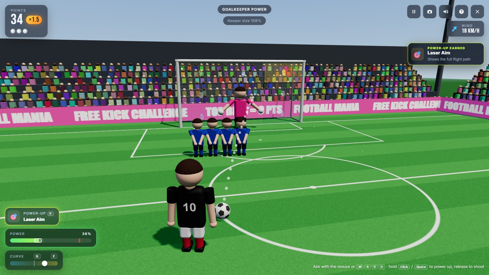
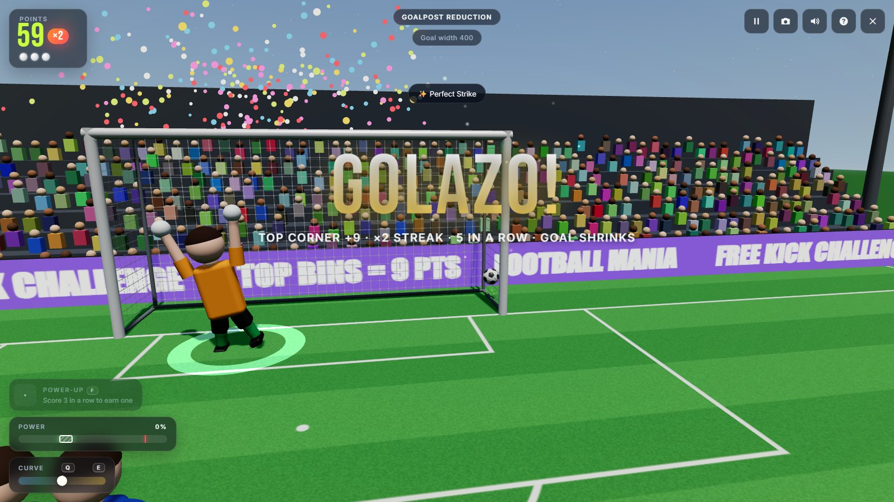
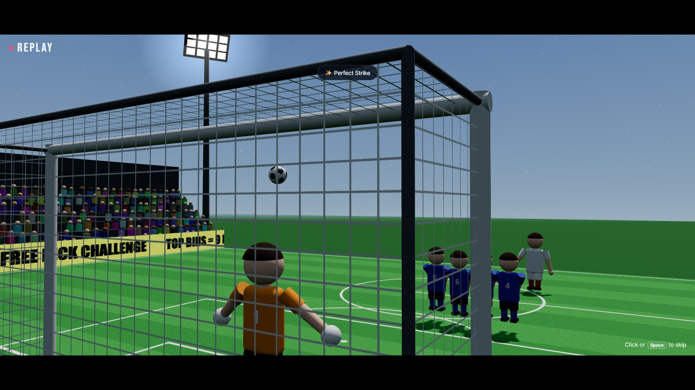
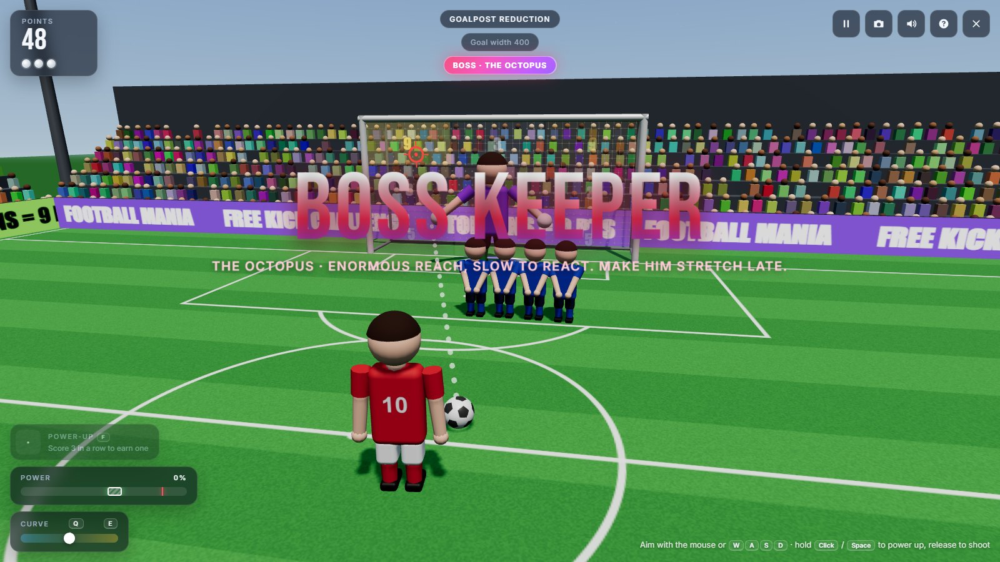
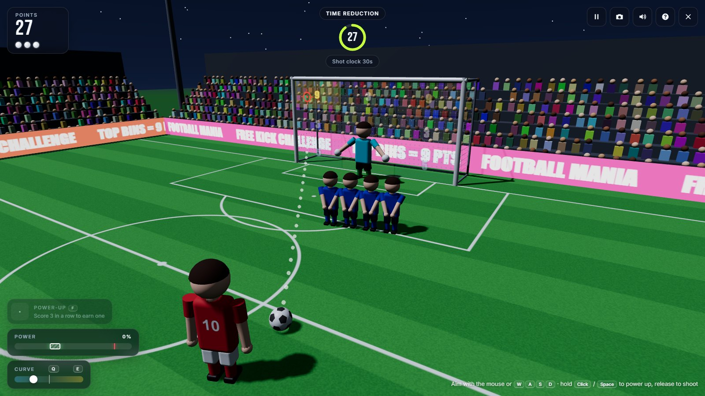
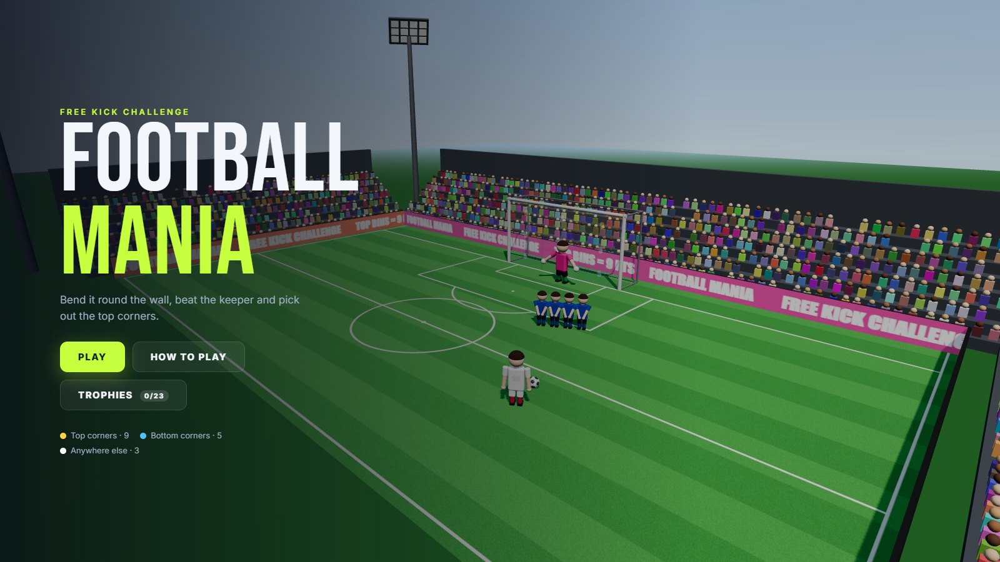
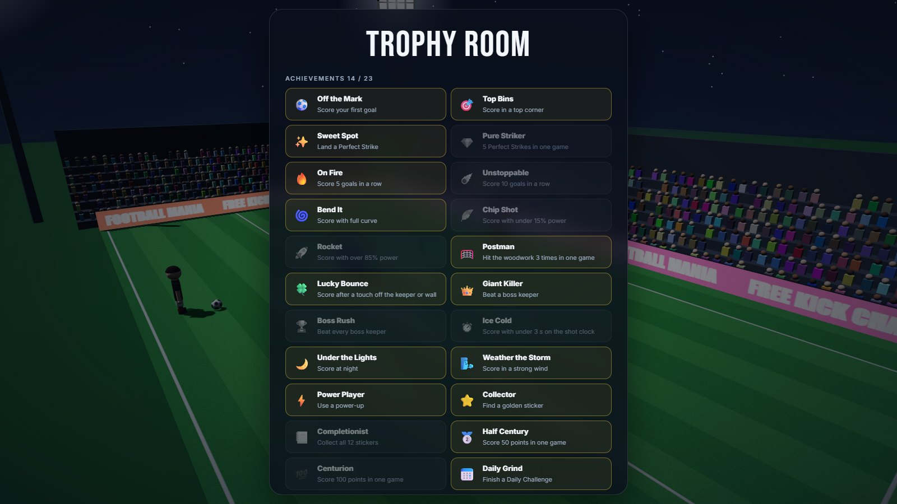

<h1 align="center">⚽ Football Mania</h1>

<p align="center">
  <b>A 3D free kick game for the browser.</b><br>
  Bend it round the wall, beat the keeper and pick out the top corners.
</p>

<p align="center">
  
  
  
  
  
</p>

<p align="center">
  
</p>

---

## Contents

- [Screenshots](#screenshots)
- [Features](#features)
- [Quick start](#quick-start)
- [How to play](#how-to-play)
- [Controls](#controls)
- [Technologies](#technologies)
- [Project structure](#project-structure)
- [Original Python version](#original-python-version)

## Screenshots

<table>
  <tr>
    <td width="50%"></td>
    <td width="50%"></td>
  </tr>
  <tr>
    <td align="center"><sub>Top-corner Perfect Strike on a ×2 streak</sub></td>
    <td align="center"><sub>Slow-motion replay from behind the net</sub></td>
  </tr>
  <tr>
    <td></td>
    <td></td>
  </tr>
  <tr>
    <td align="center"><sub>Boss keeper: The Octopus</sub></td>
    <td align="center"><sub>Under the lights, with the shot clock running</sub></td>
  </tr>
  <tr>
    <td></td>
    <td></td>
  </tr>
  <tr>
    <td align="center"><sub>Main menu</sub></td>
    <td align="center"><sub>Trophy room</sub></td>
  </tr>
</table>

## Features

**Shooting**
- Real ball flight with power, curve and topspin dip.
- Collisions with the posts, the crossbar, the keeper, the wall and a soft net.
- A **Perfect Strike** timing zone on the power bar.

**Opposition**
- A keeper that predicts where the ball will be and times its dive.
- A defensive wall that jumps when you shoot.
- Four **boss keepers**, each needing a different shot.

**Modes**
- **Daily Challenge:** the same ten kicks for every player.
- **Goalkeeper Power:** the keeper grows after each goal.
- **Goalpost Reduction:** the goal shrinks after each goal.
- **Time Reduction:** a shot clock that gets shorter after each goal.

**Progression**
- Streak multipliers and earned power-ups.
- 12 collectible stickers.
- 23 achievements, one of them secret.
- Saved best scores and a daily streak.

**Presentation**
- A full stadium with a crowd that celebrates, floodlights and a day/night cycle.
- Wind, confetti and sparks, a rippling net, slow-motion replays and camera shake.
- Sound effects synthesised in real time.

**Controls**
- Keyboard and mouse, gamepad, or touch.
- Third-person and first-person cameras.

## Quick start

Requires [Node.js](https://nodejs.org/) 18 or newer. There is nothing to install.

```bash
git clone https://github.com/AzmariSultana/Football-Mania.git
cd Football-Mania
npm start
```

Open **http://localhost:8080** in a modern desktop browser (Chrome, Edge, Firefox or Safari).

> [!NOTE]
> Opening `index.html` straight from disk won't work, because browsers block ES modules on `file://`.
> Any static server can serve the folder instead, for example `npx serve` or `python -m http.server 8080`.
> To change the port, set `PORT` (e.g. `PORT=3000 npm start`).
> Three.js and the fonts load from CDNs, so you need an internet connection on first load.

## How to play

1. Pick a mode.
2. Aim the red marker at the goal.
3. Hold the shoot button to charge power and release to shoot.

Score as many points as you can before you run out of misses.

| Zone | Points |
|:--|:--:|
| Top corners | **9** |
| Bottom corners | **5** |
| Anywhere else | **3** |

### Shooting

| Mechanic | What it does |
|:--|:--|
| **Power** | Low power lobs over the wall but gives the keeper time to read it. High power is flat and hard to save. Past the red line on the power bar, your accuracy drops. |
| **Perfect Strike** | Release inside the striped green band, which moves every kick. The ball goes exactly where you aimed and the keeper reacts later. |
| **Curve** | Bends the ball around the wall and still lands it on your marker. |
| **Wind** | Appears from your third goal and gets stronger. It pushes the ball while it's in the air. The arrow in the top right shows its direction. |
| **Preview** | The dotted line shows the start of the ball's path, with curve and wind included. |

### Game modes

| Mode | Rules |
|:--|:--|
| 📅 **Daily Challenge** | Ten fixed kicks generated from today's date, so everyone gets the same spots, wind and bosses. No miss limit. Tracks your daily best and day streak. |
| 🧤 **Goalkeeper Power** | The keeper grows 8% bigger after every goal. |
| 🥅 **Goalpost Reduction** | The goal gets narrower after every goal. |
| ⏱️ **Time Reduction** | 30 seconds per kick, 3 seconds less after every goal (minimum 5). Running out of time counts as a miss. |

In every mode except the Daily Challenge, the game ends after **three misses**.

### Streaks and rewards

- **Streak multiplier:** your third goal in a row and onwards scores **×1.5**, and from the fifth it's **×2**. While a multiplier is live, the ball catches fire and the crowd starts chanting.
- **Power-ups** are earned at 3, 6, 9 and 12 goals in a row, and by beating a boss. You hold one at a time and use it while aiming.

  | Power-up | Effect |
  |:--|:--|
  | 🎯 Laser Aim | Shows the full flight path |
  | 🧊 Ice Keeper | The keeper reacts late and guesses blind |
  | 🧱 Mini Wall | The wall shrinks for one kick |
  | 🪙 Golden Ball | Double points if it goes in |

- **Golden stickers:** a star sometimes floats inside the goal. Put the ball through it for +5 points and a new sticker. There are 12 to collect.
- **Achievements:** 23 to unlock, one of them secret. Find them in the **Trophy Room** with your sticker album.
- **Replays:** special goals are replayed in slow motion from behind the net. That covers top corners, perfect strikes, bosses, deflections, big curves and streaks.

### Boss keepers

A boss steps in every five goals (and twice in the Daily Challenge) for a single kick. Beating one is worth **+10 points** and a power-up.

| Boss | Twist | How to beat it |
|:--|:--|:--|
| 🐙 The Octopus | Enormous reach | Strike early and make him stretch |
| 🎲 The Gambler | Always dives early to a corner | Keep your nerve and go down the middle |
| 🏰 The Fortress | A six-man wall | Lob it or bend it around |
| 🪞 The Mirror | Dives towards the spots you've been aiming at | Do something new |

Best scores, achievements, stickers and the daily streak are saved in your browser.

## Controls

| Action | Keyboard and mouse | Gamepad |
|:--|:--|:--|
| Aim | Mouse, or <kbd>W</kbd> <kbd>A</kbd> <kbd>S</kbd> <kbd>D</kbd> | Left stick |
| Charge and shoot | Hold left click or <kbd>Space</kbd>, release to shoot | Hold <kbd>RT</kbd> or <kbd>A</kbd> |
| Curve left / right | <kbd>Q</kbd> / <kbd>E</kbd>, or mouse wheel | <kbd>LB</kbd> / <kbd>RB</kbd> |
| Use power-up | <kbd>F</kbd>, or click the power-up slot | <kbd>X</kbd> |
| Rotate camera | Arrow keys | Right stick |
| First / third person | Right click, or <kbd>C</kbd> | <kbd>Y</kbd> |
| Skip replay | Click, or <kbd>Space</kbd> | <kbd>A</kbd> |
| Pause / resume | <kbd>P</kbd> or <kbd>Esc</kbd> | <kbd>Start</kbd> |
| Mute / help | <kbd>M</kbd> / <kbd>H</kbd> | |

**Touch:** press and drag to aim while charging, then lift your finger to shoot.

## Technologies

| | |
|:--|:--|
| **[Three.js](https://threejs.org/) r160** | WebGL 2 rendering with soft shadows, ACES tone mapping, instanced crowds and GPU particles |
| **JavaScript (ES modules)** | No framework and no bundler. Three.js is loaded through an import map. |
| **Web Audio API** | Every sound effect and the crowd ambience are synthesised in code, so there are no audio files |
| **HTML and CSS** | HUD and menus layered over the canvas, with a responsive layout and support for reduced motion |
| **Gamepad API, localStorage** | Controller support and saved progress |
| **Node.js** | A tiny dependency-free static server for local play |

All 3D models, textures and sounds are generated in code. The only binary files in the repository are the README screenshots.

<details>
<summary><b>Under the hood</b></summary>

- **Physics:** fixed 240 Hz steps, with sphere-vs-capsule collisions against the posts and crossbar, the keeper's limbs and the wall. The net absorbs the ball.
- **Shot solver:** computes the launch velocity that lands the ball on the marker after curve and topspin are applied.
- **Keeper AI:** predicts where the ball will cross his own position and solves the step, jump and dive angle so his gloves reach that point. A reaction delay and read chance keep it fair.
- **Daily Challenge:** a seeded random generator (mulberry32) keyed to the date and kick number.
- **Replays:** fixed-rate transform recording into a preallocated buffer, played back with interpolation.
- **Performance:** resolution adapts to the frame rate, and the crowd and particles are drawn in batches. Hot paths avoid allocating memory every frame.

</details>

## Project structure

```
├── index.html            page shell, HUD and menus
├── css/
│   ├── style.css         base UI styling
│   └── features.css      streaks, bosses, power-ups, replays, trophy room
├── src/
│   ├── main.js           renderer setup and main loop
│   ├── game.js           game state machine, shooting, scoring, modes and rewards
│   ├── config.js         gameplay constants
│   ├── physics.js        shot trajectory and collisions
│   ├── camera.js         third-person, first-person, replay and menu cameras
│   ├── input.js          keyboard, pointer and gamepad
│   ├── ui.js             HUD, menus, toasts and trophy room
│   ├── audio.js          synthesised sound effects
│   ├── rng.js            seedable random numbers for the Daily Challenge
│   ├── progress.js       saved bests, achievements, stickers and daily streak
│   ├── features/         boss keepers, power-ups, replay recorder
│   ├── fx/               GPU particles
│   ├── world/            stadium, goal and net, collectibles
│   └── entities/         ball, keeper, kicker, wall, shared player model
├── docs/screenshots/     README images
├── server.js             static server used by `npm start`
├── package.json
└── football_mania.py     original Python/OpenGL version
```

## Original Python version

Football Mania began as a PyOpenGL/GLUT project. [`football_mania.py`](football_mania.py) is the original game; `Hello_openGL.py` and `Lets_draw_sth.py` are OpenGL practice scripts.

```bash
pip install PyOpenGL PyOpenGL_accelerate
python football_mania.py
```

The web version keeps the original's rules and numbers: goal and keeper sizes, the three modes, zone scoring and three misses. It also fixes several issues from the original:
- The keeper's dive now moves its collision area with it (before, the dive had no effect).
- Ball speed no longer depends on the frame rate.
- Shots curve and dip instead of flying in a straight line.
- The crowd no longer jitters.
- The Time Reduction shot clock now follows its documented rules.
- Wall players stand shoulder to shoulder.
